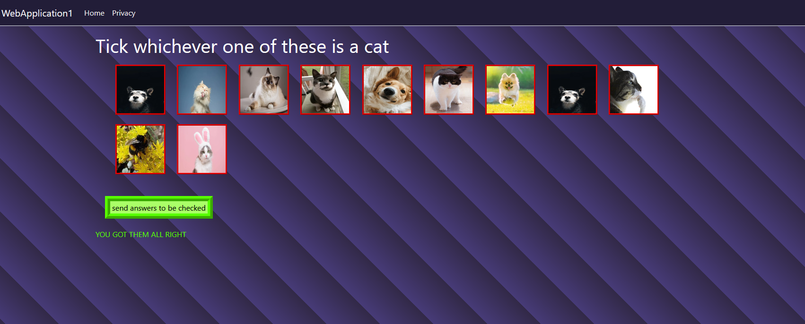

Simple MVC.net application that displays a grid of animals and asks the user to select only cats.
After they select, it displays if they selected only cats, otherwise displaying how many they got incorrect

